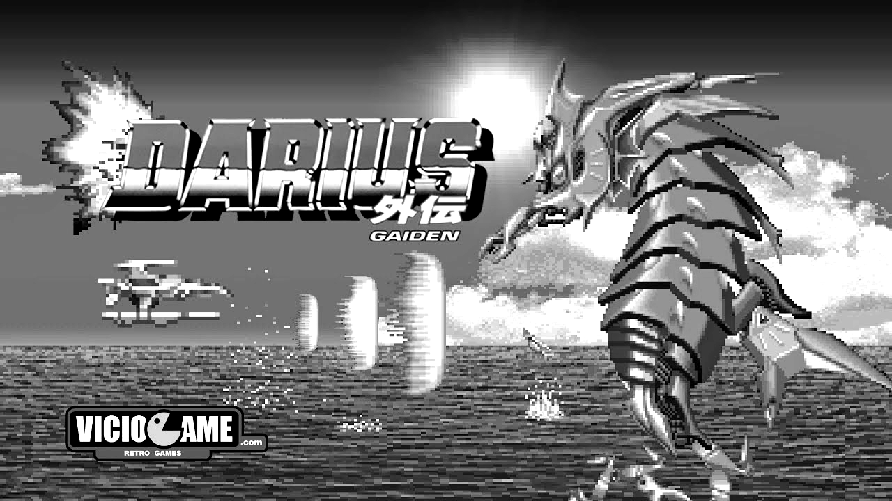
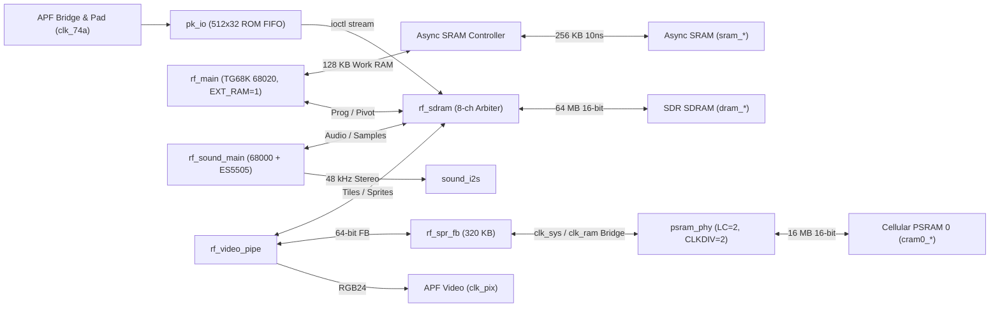

# SpaceFish

<p align="center">
  
</p>

An openFPGA port of the **Taito F3 Arcade System** for the **Analogue Pocket**, based on [`spacestate1/Arcade-taitoF3_MiSTer`](https://github.com/spacestate1/Arcade-taitoF3_MiSTer).

**SpaceFish is a multigame core**: a single unified bitstream runs the entire Taito F3 arcade library (1992–1998) on your Analogue Pocket, including *Darius Gaiden*, *Ray Force*, *Elevator Action Returns*, *Bubble Bobble II*, *Puzzle Bobble 2/3/4*, *Cleopatra Fortune*, *Arkanoid Returns*, and more!

---

## Features

- **True Multigame Architecture:** Run dozens of classic Taito F3 titles using a single core bitstream.
- **Triple External Memory Engine (Cyclone V `5CEBA4F23C8` Fit):**
  - **64 MB SDR SDRAM (`dram_*`):** Stores game ROMs (up to Profile 1's 42 MB map), tile graphics, sprite textures, Ensoniq sound samples, and pivot RAM across 8 multiplexed channels.
  - **16 MB Cellular PSRAM 0 (`cram0_*`):** Dedicated to the 320 KB double-buffered sprite framebuffer via `psram_phy.sv` with a `clk_sys` ↔ `clk_ram` 64-bit burst bridge, completely removing DDR3 requirements with zero bus contention against SDRAM.
  - **256 KB Async SRAM (`sram_*`):** Hosts the 128 KB 68EC020 main CPU work RAM (`EXT_RAM=1` in `rf_main.sv`), freeing 128 M10K blocks so the entire Taito F3 core fits comfortably inside the Analogue Pocket's 308-block M10K budget.
- **Cycle-Accurate Video:** Native 320x224 / 320x240 RGB 24-bit output with support for both standard and extended playfields (`cfg_extend`).
- **Ensoniq OTIS Sound Synthesis:** ES5505 32-voice sound engine + MB87078 attenuator driven by a dedicated 68000 sound CPU, streamed directly to the Pocket's 48 kHz stereo I2S DAC.
- **Automated Self-Configuring ROMs:** ROMs built with `tools/build_rom.py` pack hardware configuration tags (visarea, extend mode, map profile, and palette width) into a compact 16-byte header, configuring the hardware on the fly upon loading.
- **Full Dock & Custom Controls Support:** Configured for handheld and dock play with customizable action buttons and Start+Select chords.

---

## Supported Games

| Game | Setname | Visarea | Map Profile | Status |
|---|---|---|---|---|
| **Darius Gaiden - Silver Hawk** | `dariusg` | `f3` (232 lines) | Profile 0 (18.5 MB) | **Supported** |
| **Darius Gaiden Extra Version** | `dariusgx` | `f3` (232 lines) | Profile 0 (18.5 MB) | **Supported** |
| **Ray Force (US)** | `rayforce` | `f3_224a` (224 lines) | Profile 0 (18.5 MB) | **Supported** |
| **Gunlock (World)** | `gunlock` | `f3_224a` (224 lines) | Profile 0 (18.5 MB) | **Supported** |
| **Ray Force (Japan)** | `rayforcej` | `f3_224a` (224 lines) | Profile 0 (18.5 MB) | **Supported** |
| **Elevator Action Returns** | `elvactr` | `f3` (232 lines) | Profile 0 (18.5 MB) | **Supported** |
| **Bubble Bobble II** | `bublbob2` | `f3` (232 lines) | Profile 0 (18.5 MB) | **Supported** |
| **Bubble Memories** | `bubblem` | `f3` (232 lines) | Profile 0 (18.5 MB) | **Supported** |
| **Puzzle Bobble 2 / 2X** | `pbobble2` | `f3` (232 lines) | Profile 0 (18.5 MB) | **Supported** |
| **Puzzle Bobble 3** | `pbobble3` | `f3` (232 lines) | Profile 0 (18.5 MB) | **Supported** |
| **Puzzle Bobble 4** | `pbobble4` | `f3` (232 lines) | Profile 0 (18.5 MB) | **Supported** |
| **Arkanoid Returns** | `arkretrn` | `f3` (232 lines) | Profile 0 (18.5 MB) | **Supported** |
| **Cleopatra Fortune** | `cleopatr` | `f3` (232 lines) | Profile 0 (18.5 MB) | **Supported** |
| **Gekirindan** | `gekiridn` | `f3` (232 lines) | Profile 0 (18.5 MB) | **Supported** |
| **Grid Seeker - Project Storm Hammer** | `gseeker` | `f3` (232 lines) | Profile 0 (18.5 MB) | **Supported** |
| **Pop 'n Pop** | `popnpop` | `f3` (232 lines) | Profile 0 (18.5 MB) | **Supported** |
| **Twin Qix** | `twinqix` | `f3` (232 lines) | Profile 0 (18.5 MB) | **Supported** |
| **Space Invaders '95** | `spcinv95` | `f3` (232 lines) | Profile 0 (18.5 MB) | **Supported** |
| **Twin Cobra II** | `tcobra2` | `f3` (232 lines) | Profile 1 (42.0 MB) | **Supported** |
| **Kaiser Knuckle** | `kaiserkn` | `f3` (232 lines) | Profile 1 (42.0 MB) | **Supported** |
| **Dan-Ku-Ga** | `dankuga` | `f3` (232 lines) | Profile 1 (42.0 MB) | **Supported** |
| **Arabian Magic** | `arabianm` | `f3` (232 lines) | Profile 0 (18.5 MB) | **Supported** |
| **Riding Fight** | `ridingf` | `f3` (232 lines) | Profile 0 (18.5 MB) | **Supported** |
| **Ring Rage** | `ringrage` | `f3` (232 lines) | Profile 0 (18.5 MB) | **Supported** |
| **Command War** | `commandw` | `f3` (232 lines) | Profile 0 (18.5 MB) | **Supported** |
| **International Cup 94** | `intcup94` | `f3` (232 lines) | Profile 0 (18.5 MB) | **Supported** |
| **Land Maker** | `landmakr` | `f3` (232 lines) | Profile 0 (18.5 MB) | **Supported** |
| **Light Bringer** | `lightbr` | `f3` (232 lines) | Profile 0 (18.5 MB) | **Supported** |
| **Puchi Carat** | `puchicar` | `f3` (232 lines) | Profile 0 (18.5 MB) | **Supported** |
| **Quiz Theater - 3tsu no Monogatari** | `qtheater` | `f3` (232 lines) | Profile 0 (18.5 MB) | **Supported** |
| **Quiz de Hyuuhyuu** | `quizhuhu` | `f3` (232 lines) | Profile 0 (18.5 MB) | **Supported** |
| **Recalhorn** | `recalh` | `f3` (232 lines) | Profile 0 (18.5 MB) | **Supported** |
| **Super Cup Finals** | `scfinals` | `f3` (232 lines) | Profile 0 (18.5 MB) | **Supported** |
| **Taito Cup Finals** | `cupfinal` | `f3` (232 lines) | Profile 0 (18.5 MB) | **Supported** |
| **Taito Power Goal** | `pwrgoal` | `f3` (232 lines) | Profile 0 (18.5 MB) | **Supported** |
| **Top Ranking Stars** | `trstar` | `f3` (232 lines) | Profile 0 (18.5 MB) | **Supported** |

---

## Installation & Setup

1. Download the latest release ZIP from the [Releases](Release/) folder (`SpaceFish_Pocket_v1.0.1.zip`).
2. Extract the contents directly to the root of your Analogue Pocket MicroSD card:
   ```
   /
   ├── Assets/
   │   └── taitof3/
   │       ├── common/
   │       │   └── (place your .rom files here)
   │       └── danimanx.SpaceFish/
   │           ├── Darius Gaiden - Silver Hawk.json
   │           ├── Ray Force (US).json
   │           └── ...
   ├── Cores/
   │   └── danimanx.SpaceFish/
   │       ├── bitstream.rbf_r
   │       ├── core.json
   │       ├── data.json
   │       ├── video.json
   │       ├── audio.json
   │       ├── input.json
   │       ├── interact.json
   │       └── icon.bin
   └── Platforms/
       ├── taitof3.json
       └── _images/
           └── taitof3.bin
   ```
3. Generate your `.rom` files from verified MAME 0.288 ROM sets using `tools/build_rom.py`:
   ```bash
   python3 tools/build_rom.py upstream/Arcade-taitoF3_MiSTer/releases/"Darius Gaiden.mra" /path/to/mame/zips Assets/taitof3/common/dariusg.rom
   ```
4. Insert your MicroSD card into the Analogue Pocket, navigate to **openFPGA** → **Taito F3 System**, select your game, and enjoy!

---

## Default Controls

| Pocket Button | Arcade Function |
|---|---|
| **D-Pad** | 8-Way Joystick |
| **Y** | Button 1 (Shot / Action 1) |
| **B** | Button 2 (Bomb / Action 2) |
| **A** | Button 3 |
| **X** | Button 4 |
| **L1** | Button 5 |
| **R1** | Button 6 |
| **Start** | 1P Start |
| **Select** | Insert Coin |
| **L2** | Service / Test Switch |
| **Start + Select** | Pause Core |

---

## Building from Source

### Requirements
- Intel Quartus Prime Lite Edition (verified on **25.1 Lite** and **18.1.1**).
- Cyclone V device support (`5CEBA4F23C8`).
- Python 3 with Pillow (`pip install pillow`).

### Compile Bitstream
```bash
# Full synthesis, fitting, and bitstream generation
./tools/build_pocket.sh

# Or fit-only for fast iteration
./tools/build_pocket.sh --fit-only
```

### Package Release
```bash
python3 tools/package_pocket.py
```
This generates the bit-reversed `bitstream.rbf_r`, copies the APF metadata, and creates `Release/SpaceFish_Pocket_v1.0.1.zip`.

---

## Technical Architecture

### Hardware Schematic & Memory Map



- **Verified Quartus Prime 25.1 Lite Fit (`5CEBA4F23C8`):**
  - Logic utilization: `11,449 / 18,480 ALMs (62%)`
  - Block memory bits: `2,489,472 / 3,153,920 (79%)` (`308 / 308` RAM blocks)
  - DSP blocks: `17 / 66 (26%)`

See [`PORTING.md`](PORTING.md) for full architectural documentation, including:
- Cyclone V PLL clock synthesis (`f3_pll.sv`).
- SDRAM 8-channel arbiter mapping (`rf_sdram.sv`).
- Cellular PSRAM 0 sprite framebuffer controller (`rf_spr_fb.sv` + `psram_phy.sv`).
- Async SRAM 128 KB main work RAM bridge (`f3_pocket_top.sv` + `rf_main.sv`).
- APF Data slot streaming protocol (`pk_io.sv`).

---

## Contributing

Contributions, test reports, and hardware verification are welcome!

- **Porting & Architectural Reference:** Review [`PORTING.md`](PORTING.md) for details on memory bus arbiter channels, PSRAM framebuffer integration, and PLL clock synthesis.
- **ROM Generation & Packaging:** Use `tools/build_rom.py` and `tools/package_pocket.py` to produce properly tagged `.rom` files and openFPGA release bundles.
- **Game Compatibility & Edge Cases:** Refer to test cases documented in [`PORTING.md`](PORTING.md) (such as *Gekirindan*, *Ray Force*, and *Darius Gaiden*) to verify video visarea, extend mode flags, and sound CPU synchronization.
- **Pull Requests:** Please ensure changes compile cleanly in Quartus (`./tools/build_pocket.sh --fit-only` or full build) without violating the Analogue Pocket's 308 M10K block limit.

---

## License & Credits

- Port developed by **DanimanX**.
- Original Taito F3 MiSTer core by **spacestate1** ([Arcade-taitoF3_MiSTer](https://github.com/spacestate1/Arcade-taitoF3_MiSTer)).
- TG68K.C 68020/68000 CPU core by **Tobias Gubener**.
- ES5505 Ensoniq sound core by **spacestate1**.
- openFPGA APF framework and tools by **Analogue**.
- Licensed under the **GNU General Public License v3.0 (GPL-3.0)**.
